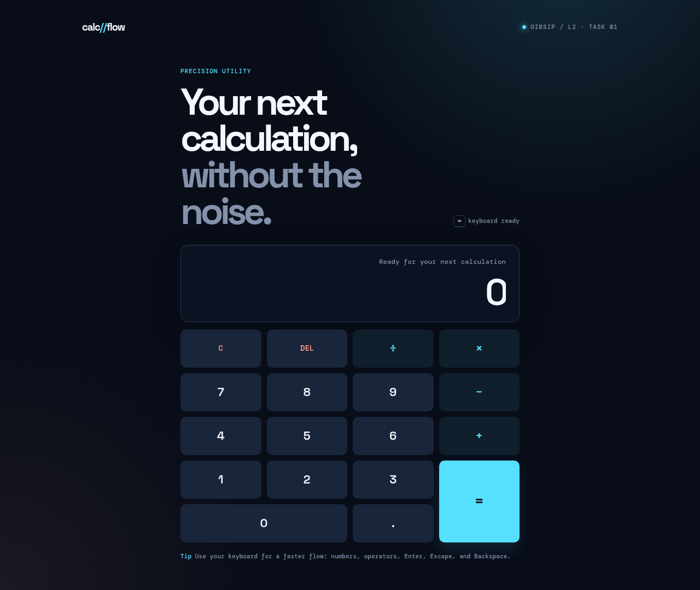
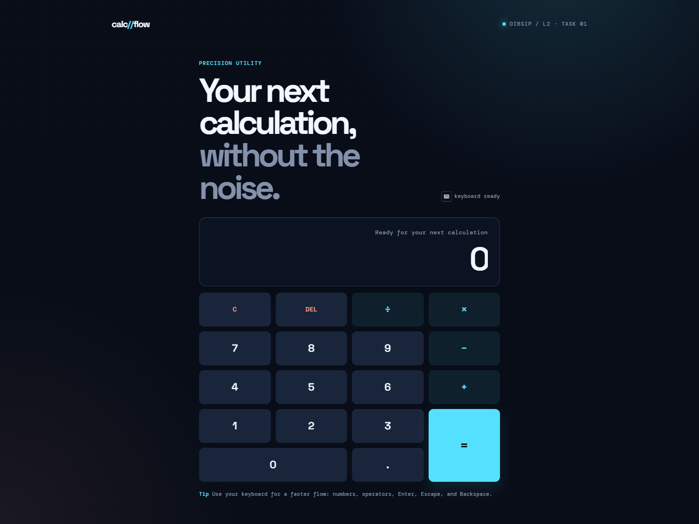
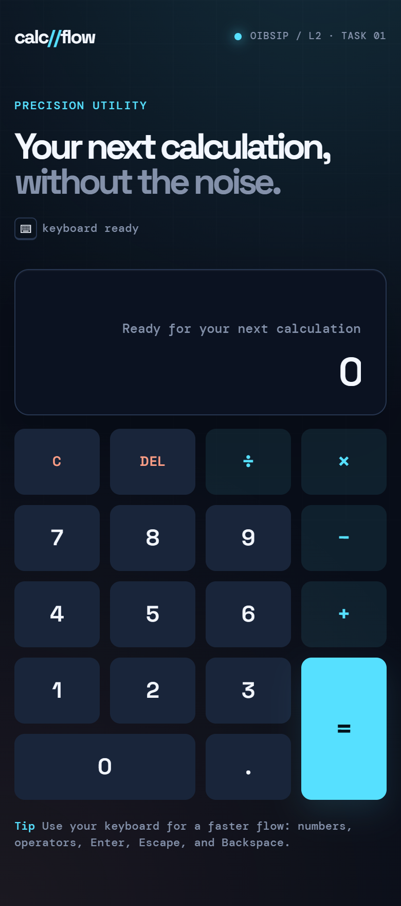
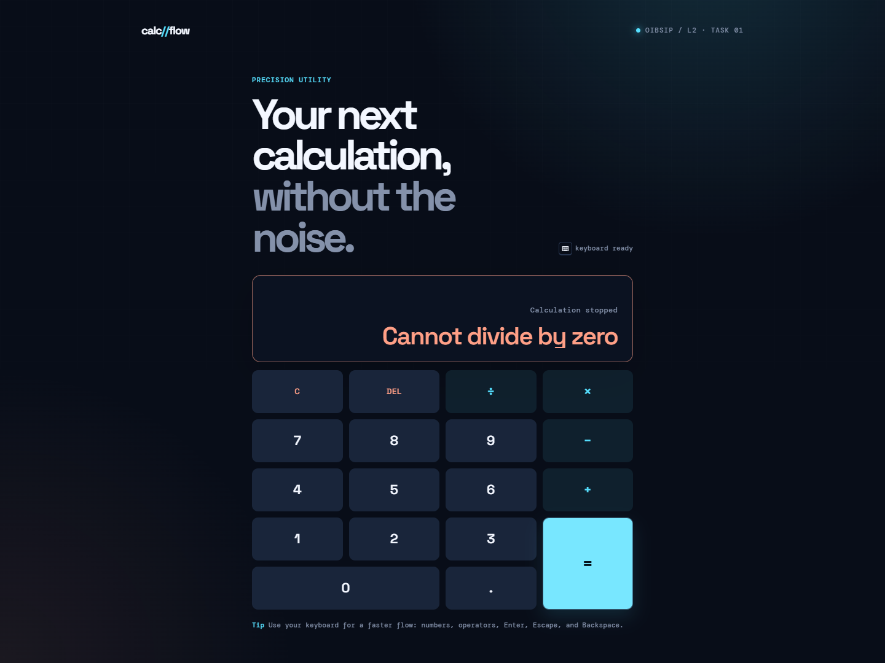
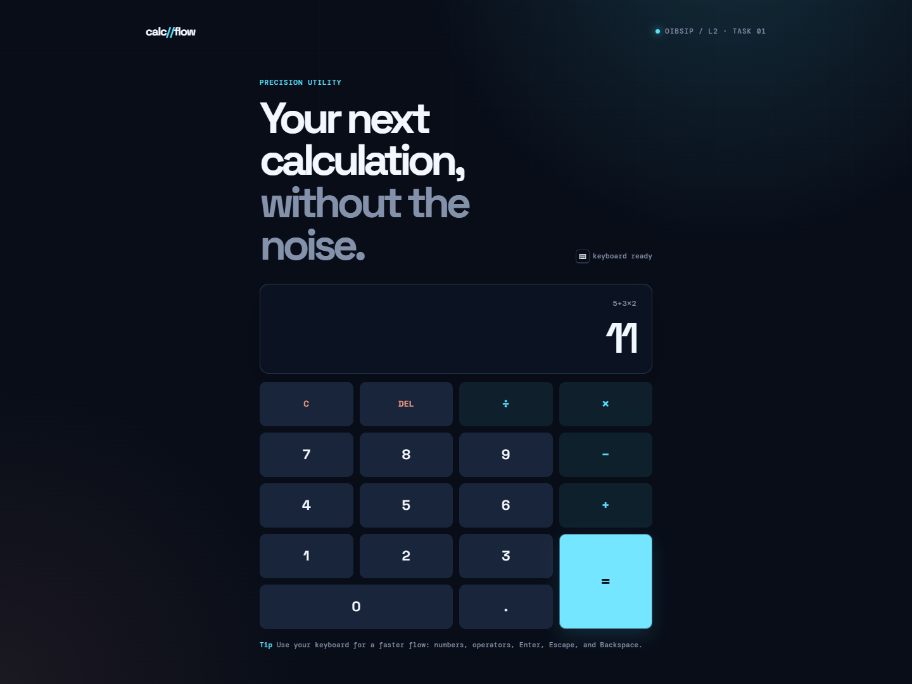

# Calculator

A responsive browser-based calculator built with semantic HTML5, CSS3 Grid, and vanilla JavaScript for the Oasis Infobyte Web Development and Designing internship.

**Internship:** Oasis Infobyte — Web Development and Designing  
**Level / Task:** Level 2 — Task 1  
**Author:** Abdelrahman Mohammed Mahmoud  
**Status:** In progress — implementation and demo video complete; final submission assets pending



## Live Demo

To be added after GitHub Pages is enabled.

## Demo Video

[Watch the calculator demo](./OIBSIP-Calculator-Demo.mp4)

## Screenshots

| Desktop | Mobile |
|---|---|
|  |  |

| Division by zero | Chained operation |
|---|---|
|  |  |

## Features

- Two-line display showing the current expression and result
- Numeric buttons `0–9` and a decimal point
- Addition, subtraction, multiplication, and division
- Equals button with safe expression evaluation
- Clear (`C`) and delete (`DEL`) buttons
- Division-by-zero error message instead of a crash
- Operator chaining with standard precedence: `5 + 3 × 2 = 11`
- CSS Grid keypad layout
- `addEventListener` on every button; no inline `onclick`
- No `eval()` or `Function()`; manual tokenizer and precedence evaluation
- Responsive and accessible layout
- Keyboard support

## Tech Stack

- **HTML5** — semantic structure and accessible controls
- **CSS3** — Grid, custom properties, responsive media queries
- **Vanilla JavaScript** — no frameworks, no build step

## How to Run

Open `index.html` directly in a browser. No installation or build step is required.

To serve it locally instead:

```bash
npx serve .
```

Then open `/WebDev-L2-Task1-Calculator/` on the local server.

## Project Files

- `index.html` — page structure and button interface
- `styles.css` — responsive visual system and CSS Grid layout
- `script.js` — input state, event handling, tokenizer, precedence evaluation, and error handling
- `screenshots/` — interface previews and state captures
- `README.md` — project documentation

## How It Works

- `tokenize()` converts the expression into numbers and operators, including unary signs.
- `evaluateTokens()` reduces the tokens using operator precedence, so multiplication and division run before addition and subtraction.
- No `eval()` or `Function()` is used.
- Division by zero is detected before the division and reported as `Cannot divide by zero`.
- Results are formatted to avoid floating-point display artifacts such as `0.30000000000000004`.
- Keyboard input mirrors the buttons: numbers, `.`, `+`, `-`, `*`, `/`, `Enter` or `=`, `Backspace`, and `Escape`.

## Behavior

- `5 + 3 × 2 =` → `11`
- `8 ÷ 0 =` → `Cannot divide by zero`
- `0.5 + 0.25 =` → `0.75`
- `9 − 12 =` → `−3`
- After `=`, an operator continues from the result; a digit starts a new expression.
- `DEL` removes the last entered character.
- `C` resets the calculator.
- Duplicate decimals and leading zeros are handled.
- After an error, entering a new number starts a fresh calculation.

## Verification

Verified in a browser at desktop and mobile widths:

- All buttons respond through `addEventListener`
- `5 + 3 × 2 =` returns `11`
- `8 ÷ 0 =` displays `Cannot divide by zero`
- `DEL` removes the last character
- `C` resets the display
- Decimals and negative results display correctly
- No console errors
- No inline `onclick` attributes
- No `eval()` or `Function()` calls
- CSS Grid is used for the keypad

## Task Card Checklist

| Requirement | Implementation |
|---|---|
| Display shows current input and result | Two-line expression/result display |
| Numeric buttons `0–9` and decimal point | Numeric keypad |
| Operator buttons `+ − × ÷` | Operator keys with active state |
| Equals button | Safe parser evaluation |
| Clear button | Resets input, result, and error state |
| Backspace/Delete button | `DEL` removes the last character |
| Division-by-zero error message | Friendly error, no crash |
| Operator chaining | Expression builder with standard precedence |
| CSS Grid button layout | Four-column keypad grid |
| Event listeners, no inline `onclick` | All events wired in `script.js` |

## Accessibility & Responsiveness

- Semantic `<button>` elements with accessible labels
- Visible focus states
- `aria-live` result display
- Responsive layout with a 320px minimum width; verified at 390px
- Respects `prefers-reduced-motion`

## Limitations

The calculator does not include parentheses, percentages, memory, or history, as these are outside the task requirements.

## Author

Abdelrahman Mohammed Mahmoud  
Oasis Infobyte Internship — Web Development and Designing
