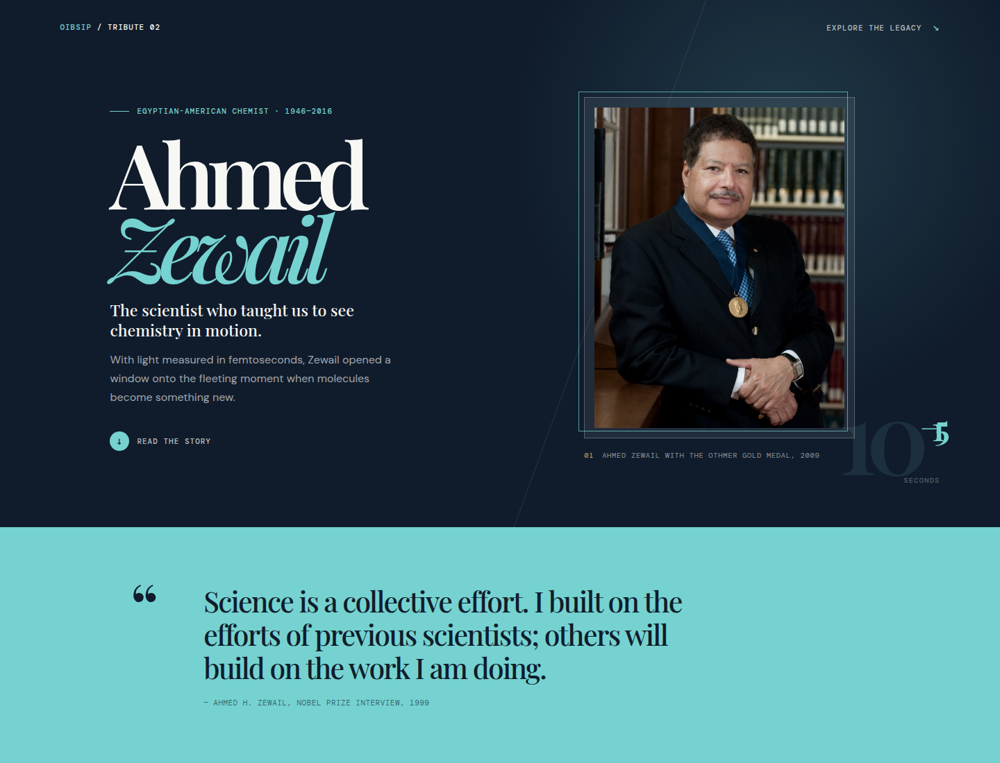
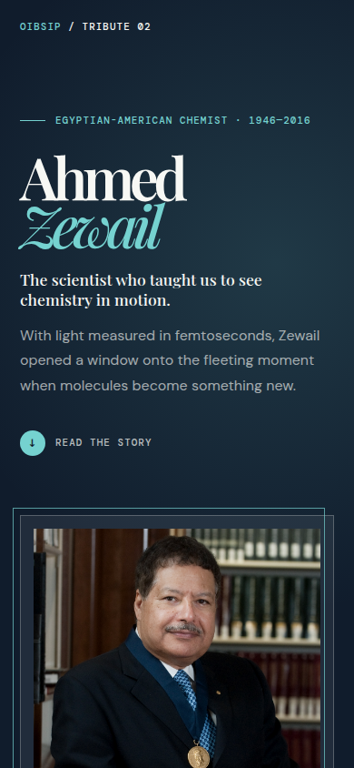
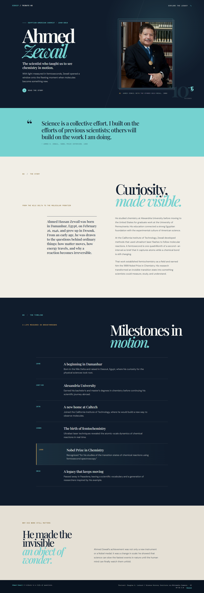
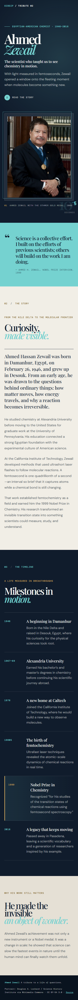

# Tribute Page

A responsive editorial tribute page celebrating **Ahmed Zewail**, the Egyptian-American chemist who pioneered femtochemistry.

**Internship:** Oasis Infobyte — Web Development and Designing  
**Level / Task:** Level 2 — Task 2  
**Author:** Abdelrahman Mohammed Mahmoud  
**Status:** Complete — implementation, screenshots, live demo, and demo video finished



## Live Demo

[Open the live tribute page](https://abdoh012.github.io/OIBSIP/WebDev-L2-Task2-TributePage/)

[Project hub](https://abdoh012.github.io/OIBSIP/)

## Demo Video

[Watch the tribute page demo](./OIBSIP-Tribute-Page-Demo.mp4)

## Screenshots

| Desktop hero | Mobile hero |
|---|---|
|  |  |

| Full desktop page | Full mobile page |
|---|---|
|  |  |

## Features

- Subject name and one-line tagline
- Prominent portrait with descriptive alt text
- Four original biography paragraphs
- Six-item timeline of key achievements
- Styled quote block with citation
- Multiple contrasting background sections
- Serif, sans-serif, and monospace typography
- Responsive editorial layout
- Smooth in-page navigation with reduced-motion support
- Locally stored, optimized portrait image
- Source notes and image attribution

## Tech Stack

- **HTML5** — semantic sections, figure, blockquote, timeline list, and footer
- **CSS3** — custom properties, Grid, Flexbox, fluid type, media queries
- **No JavaScript** — the task does not require it

## How to Run

Open `index.html` directly in a browser. No installation or build step is required.

To serve it locally instead:

```bash
npx serve .
```

Then open `/WebDev-L2-Task2-TributePage/` on the local server.

## Project Files

- `index.html` — semantic page structure and content
- `styles.css` — visual system, responsive layout, and contrast fixes
- `research.md` — verified facts, source notes, and image attribution
- `assets/ahmed-zewail-portrait.jpg` — optimized portrait image
- `screenshots/` — hero and full-page captures
- `README.md` — project documentation

## Content and Sources

The page copy is original paraphrase based on:

- [NobelPrize.org — Ahmed Zewail facts](https://www.nobelprize.org/prizes/chemistry/1999/zewail/facts/)
- [NobelPrize.org — Ahmed Zewail biography](https://www.nobelprize.org/prizes/chemistry/1999/zewail/biographical/)
- [Wikipedia — Ahmed Zewail](https://en.wikipedia.org/wiki/Ahmed_Zewail)

The displayed quote is a short excerpt from [Zewail’s official Nobel Prize interview](https://www.nobelprize.org/prizes/chemistry/1999/zewail/interview/).

See [`research.md`](./research.md) for the full source notes.

## Image Credit

The portrait is “Ahmed Zewail HD2009 Othmer Gold Medal portrait.JPG,” photographed by **Douglas A. Lockard** and shared through [Wikimedia Commons](https://commons.wikimedia.org/wiki/File:Ahmed_Zewail_HD2009_Othmer_Gold_Medal_portrait.JPG) under **CC BY-SA 3.0**. Attribution and license are also included in the page footer.

## Task Card Checklist

| Requirement | Implementation |
|---|---|
| Page title with subject name and tagline | “Ahmed Zewail” with “The scientist who taught us to see chemistry in motion.” |
| Prominent image from a royalty-free source | Locally stored Wikimedia Commons portrait with attribution |
| Biography or tribute with 3–4 paragraphs | Four original paragraphs in the story section |
| Timeline or key achievements | Six-item ordered timeline |
| Styled quote block | Full-width cyan quote band with citation |
| At least two background colours | Navy, cyan, paper, paper-deep, and navy-deep sections |
| At least two font styles | Playfair Display, DM Sans, and DM Mono |
| Responsive layout | Tested from 320px through 1440px |

## Accessibility & Responsiveness

- Semantic `header`, `main`, `section`, `figure`, `blockquote`, and `footer` elements
- `aria-labelledby` labels for major sections
- Descriptive image alt text and figure caption
- Improved text contrast for small labels and body copy
- `prefers-reduced-motion` support
- No horizontal overflow at 320, 390, 768, 1024, or 1440px

## Verification

- Page title, tagline, portrait, biography, timeline, and quote all render correctly
- Four biography paragraphs and six timeline items confirmed
- Both in-page anchor links work
- Portrait loads at 1200×1635 and is compressed from 3.5 MB to about 148 KB
- Multiple section backgrounds and three font families confirmed
- Mobile navigation and stacked hero layout work
- No console errors during local browser testing

## Author

**Abdelrahman Mohammed Mahmoud** — Oasis Infobyte Internship — Web Development and Designing
