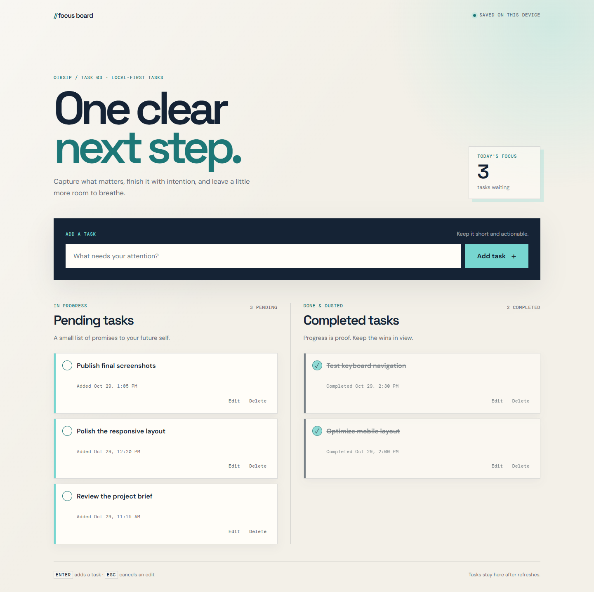
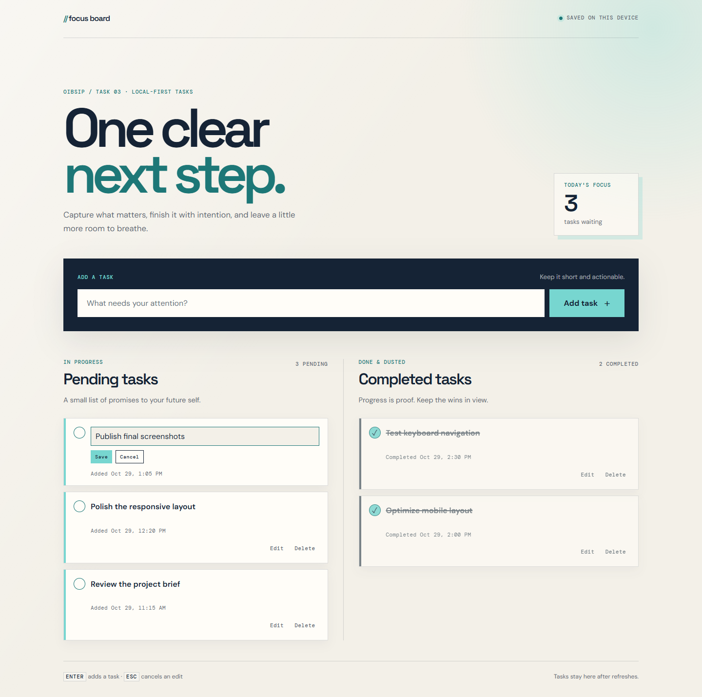
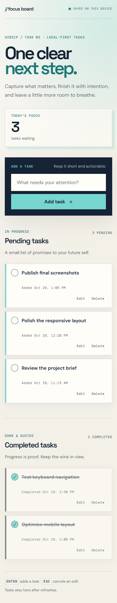
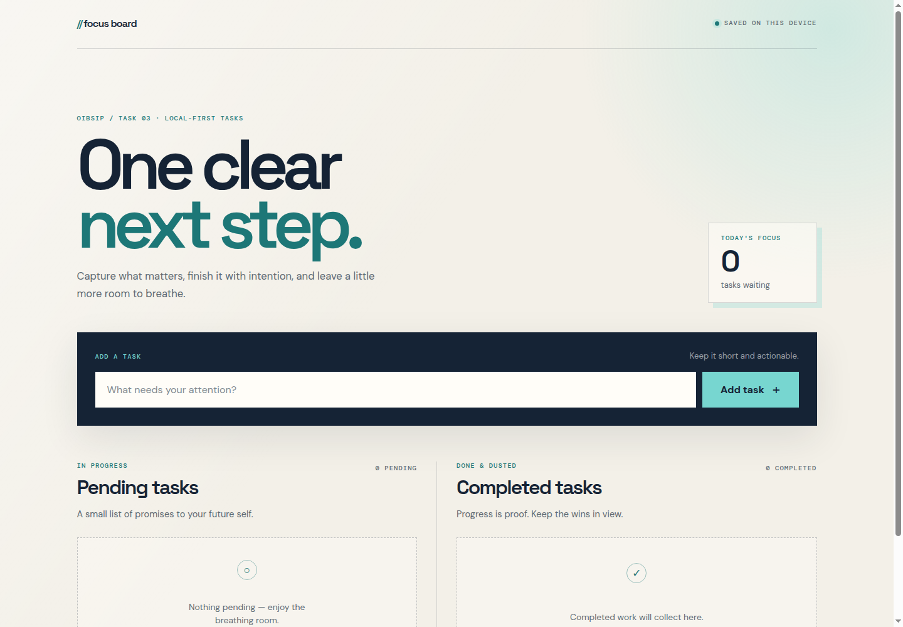

# OIBSIP Level 2 — To-Do Web App

**Quiet Focus Board** is a responsive, local-first task manager built with HTML5, CSS3, and vanilla JavaScript.

**Internship:** Oasis Infobyte — Web Development and Designing  
**Level / Task:** Level 2 — Task 3  
**Author:** Abdelrahman Mohammed Mahmoud  
**Status:** Complete — implementation, screenshots, live demo, and demo video finished

## Live Demo

[Open the To-Do Web App](https://abdoh012.github.io/OIBSIP/WebDev-L2-Task3-ToDoWebApp/)

[Project hub](https://abdoh012.github.io/OIBSIP/)

## Demo Video

[Watch the To-Do App demo](./OIBSIP-To-Do-App-Demo.mp4)

## Objective

Build an interactive to-do list application that lets users add, complete, edit, and delete tasks, with clear pending and completed sections and persistent local state.

## Features

- Add a task with the **Add task** button or the **Enter** key.
- Show new tasks immediately in the **Pending tasks** list.
- Toggle a task between pending and completed with its circular completion button.
- Edit task text inline with **Save**, **Cancel**, or the **Escape** key.
- Delete a task permanently from either list.
- Display live **X pending** and **Y completed** counters.
- Show the time each task was added or completed.
- Persist tasks across page refreshes with `localStorage`.
- Show friendly empty states for both lists.
- Keep multiple tabs in sync through the browser `storage` event.
- Validate empty submissions and empty edits with visible error messages.
- Preserve keyboard focus after saving, cancelling, toggling, and deleting.
- Render task text as text, not HTML, so pasted markup stays inert.
- Recover safely when saved data is missing, malformed, or partially invalid.

## Screenshots

### Populated board — desktop



### Inline editing



### Populated board — mobile



### Empty state



## How to Run

From the repository root:

```bash
python -m http.server 8000
```

Then open:

```text
http://localhost:8000/WebDev-L2-Task3-ToDoWebApp/
```

You can also use the VS Code Live Server extension. A local server is recommended because `localStorage` behavior with direct `file:` URLs is not guaranteed across browsers.

## How It Works

- A single `tasks` array is the source of truth; `render()` rebuilds both lists from that state.
- Tasks are stored as JSON under the `oibsip-quiet-focus-tasks-v1` `localStorage` key.
- `loadTasks()` uses defensive parsing and filters malformed records so a bad stored value cannot break the app.
- Inline editing is handled by a small form inside the affected task card.
- The `storage` event reloads tasks when another tab changes the same key.
- Timestamps are formatted with `Intl.DateTimeFormat`.
- The completion toggle, Edit, and Delete controls include task-specific accessible labels.
- A polite live region announces successful actions; visible `role="alert"` messages handle validation failures.

## Testing Checklist

- [x] Add via button and Enter; empty submissions show a visible error.
- [x] Pending and completed counts update after every action.
- [x] Toggle pending → completed and completed → pending.
- [x] Edit with Save, Cancel, and Escape; empty edits show a visible inline error.
- [x] Delete from both lists.
- [x] Tasks survive a full page reload.
- [x] Corrupt `localStorage` data falls back to an empty board.
- [x] Cross-tab updates appear without a reload.
- [x] Pasted HTML is displayed literally and does not execute.
- [x] Keyboard focus returns to the relevant control after actions.
- [x] No horizontal overflow at 320, 390, 768, 1024, or 1440 pixels.
- [x] No console errors after adding the favicon.

## Tech Stack

- HTML5
- CSS3
- Vanilla JavaScript
- Browser `localStorage`
- `Intl.DateTimeFormat`
- `crypto.randomUUID()` with a timestamp/random fallback

## Limitations

Tasks live only in the current browser profile. Clearing site data removes them, and tasks do not sync across devices.

## Author

Abdelrahman Mohammed Mahmoud  
Oasis Infobyte Internship — Web Development and Designing
