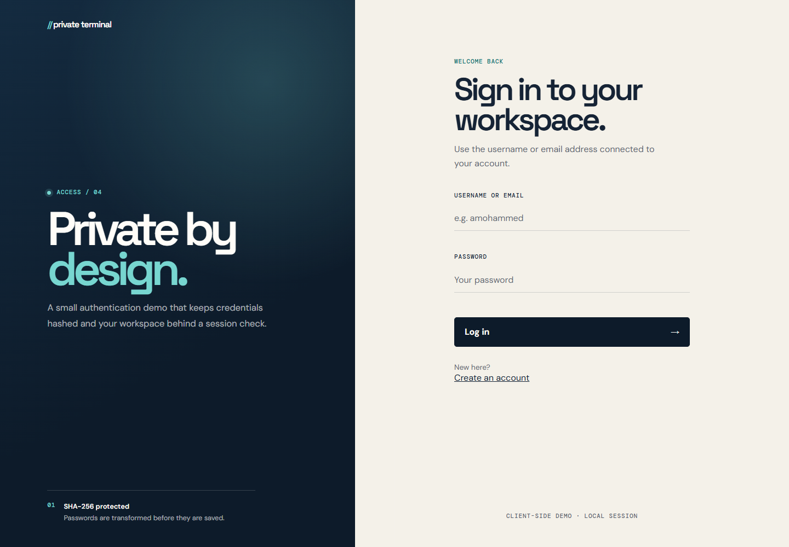
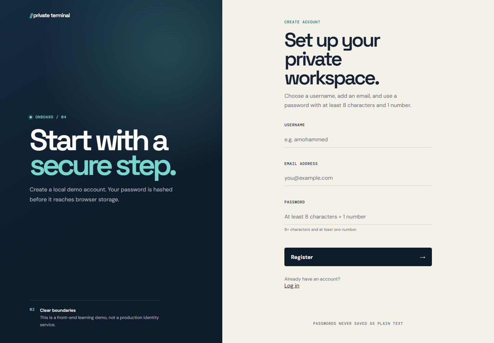
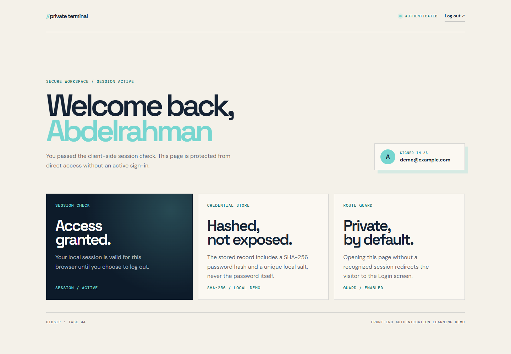
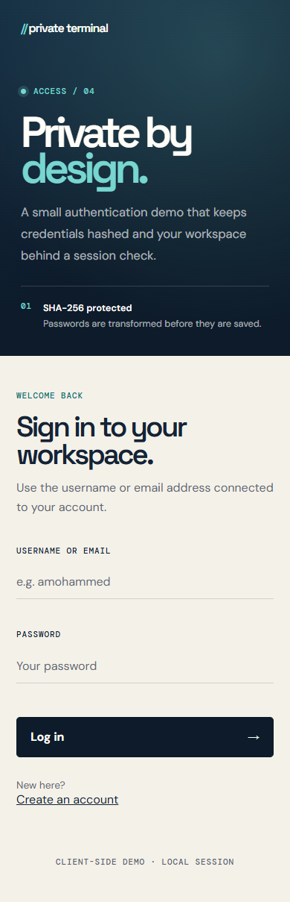
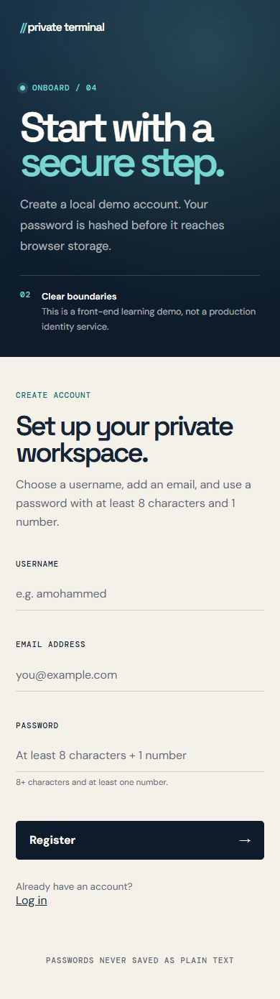
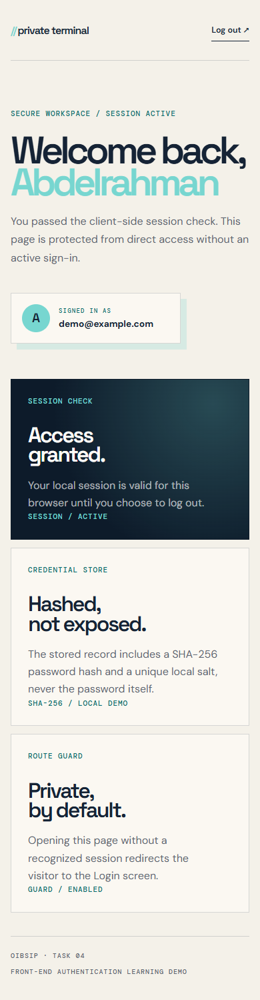

# OIBSIP Level 2 — Login Authentication System

**Private Terminal** is a responsive, front-end-only authentication demo built with HTML5, CSS3, vanilla JavaScript, Web Crypto, and browser `localStorage`.

**Internship:** Oasis Infobyte — Web Development and Designing  
**Level / Task:** Level 2 — Task 4  
**Author:** Abdelrahman Mohammed Mahmoud  
**Status:** Complete — implementation, screenshots, live demo, and demo video finished

## Live Demo

[Open the Login Authentication System](https://abdoh012.github.io/OIBSIP/WebDev-L2-Task4-LoginAuthenticationSystem/)

The folder entry point redirects to `login.html`.

[Project hub](https://abdoh012.github.io/OIBSIP/)

## Demo Video

[Watch the Auth System demo](./OIBSIP-Auth-System-Demo.mp4)

## Features

- Registration form with username, email, and password.
- Password validation: at least 8 characters and at least 1 number.
- Email format validation and a minimum username length of 3 characters.
- Case-insensitive duplicate username and email checks.
- Login with either username or email.
- One generic message for incorrect credentials, without revealing which field was wrong.
- Salted SHA-256 password hashing with Web Crypto.
- No plain-text passwords stored in `localStorage`.
- A local session is created after a successful login.
- Protected dashboard: visiting it without a valid session redirects to login.
- Logout clears the session and returns to login.
- Validation messages for empty login and registration submissions.
- Accessible labels, `aria-invalid` states, linked field errors, and a polite live region.
- Responsive layouts for desktop and mobile.
- Defensive storage parsing so malformed saved data cannot break the app.

## Screenshots

### Login — desktop



### Register — desktop



### Protected dashboard — desktop



### Login — mobile



### Register — mobile



### Protected dashboard — mobile



## Test Flow

1. Open `register.html` and create an account using a password such as `Portfolio2026`.
2. Sign in with the username or email you created.
3. Visit `dashboard.html` while signed in, then choose **Log out**.
4. Open `dashboard.html` again to confirm that the route guard redirects you to `login.html`.

## Run Locally

From the repository root:

```bash
python -m http.server 8000
```

Then open:

```text
http://localhost:8000/WebDev-L2-Task4-LoginAuthenticationSystem/
```

Use `localhost` or HTTPS. The Web Crypto API required for password hashing is not available in an insecure `file:` context. Do not open the HTML files directly from disk.

## How It Works

- `index.html` redirects to the login screen so the GitHub Pages directory URL opens the app.
- `auth.js` handles registration, login, the dashboard guard, and logout.
- User records and the session are stored under separate `localStorage` keys.
- Passwords are hashed as `SHA-256(salt + ":" + password)` and saved as hex.
- The salt is generated with `crypto.getRandomValues()`.
- `getUsers()` and `getSession()` use defensive parsing and discard malformed records.
- Dashboard identity fields are rendered with `textContent`, not HTML.
- The `storage`-safe helpers keep the app from crashing when browser storage is unavailable.
- The dashboard only removes its loading state after a recognized session is found.

## Testing Checklist

- [x] Empty registration and login submissions show visible errors.
- [x] Username, email, and password validation behave as required.
- [x] Duplicate usernames and emails are rejected case-insensitively.
- [x] Stored records contain a SHA-256 hash and salt, not the password.
- [x] Two accounts using the same password produce different hashes.
- [x] Login works with both username and email.
- [x] Incorrect credentials show one generic message.
- [x] Session survives a page reload.
- [x] Direct dashboard access without a session redirects to login.
- [x] A tampered session is rejected and cleared.
- [x] Logout clears the session and redirects.
- [x] No horizontal overflow at 320, 390, 768, or 1440 pixels.
- [x] No console errors after adding the favicon.

## Tech Stack

- HTML5
- CSS3
- Vanilla JavaScript
- Web Crypto API (`crypto.subtle.digest`, `crypto.getRandomValues`)
- Browser `localStorage`

## Security Scope

This is an internship demonstration, not production authentication. Client-side hashing with SHA-256 is used only because the task permits a front-end-only approach. For a real product, use a server-side database, Argon2 or bcrypt password hashing, HTTPS, rate limiting, HttpOnly/Secure cookies, CSRF protections where applicable, and server-side authorization checks.

See [`research.md`](./research.md) for the MDN-backed implementation notes and sources.

## Author

Abdelrahman Mohammed Mahmoud  
Oasis Infobyte Internship — Web Development and Designing
